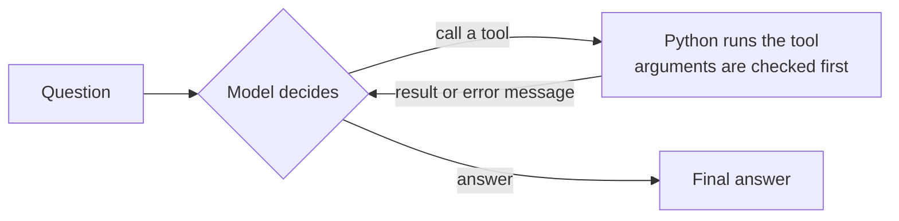

# Analyst Agent: a tool-calling AI agent with a real test


A small AI agent in plain Python, **without a framework**. It answers questions about the risk factors in
the annual reports of 20 US companies. It does not guess: it calls tools on real data, and every answer is
**checked automatically** against the correct value.

Most agent demos show one nice example. This one answers the harder question: **how often is it right?**

## What it does

```
You: By how many points did Chevron's 'Regulatory & Legal' share change from 2020 to 2021?
  [step 1: get_risk_mix({'company': 'Chevron', 'year': 2020})]
  [step 1: get_risk_mix({'company': 'Chevron', 'year': 2021})]
  [step 2: calculator({'expression': '30.4 - 17.4'})]
Agent: It rose by 13.0 percentage points (17.4% → 30.4%).
```

```
You: What share of Netflix's 2022 risk factors is about cyber risk?
  [step 1: get_risk_mix({'company': 'Netflix', 'year': 2022})]   -> error: no data for Netflix
Agent: The data does not cover Netflix, so I cannot answer this.
```

The second example matters as much as the first: an agent that invents a number is worse than no agent.

## How it works



1. The question and the tool descriptions go to the model.
2. The model either answers, or asks for one or more tools with arguments.
3. `agent/loop.py` checks the arguments and runs the real Python functions.
4. The results go back to the model. This repeats until it answers, at most 8 times.

The model never executes anything itself. It plans; the code runs. This reason → act → observe loop (ReAct)
is what agent frameworks wrap. Here it is about 60 lines you can read.

## The tools

| Tool | What it is for |
|---|---|
| `list_companies` | Which companies and years the data covers |
| `get_risk_mix` | One company, one year: how the Risk Factors section splits across 13 risk types |
| `rank_companies` | One risk type, one year: all companies ranked |
| `count_keyword` | How many passages mention a word |
| `search_passages` | Find the passages that match some words, to quote the report |
| `calculator` | Exact arithmetic, safe (no `eval`) |
| `web_search` | Anything outside the data |

The data is a snapshot from my [Risk Radar](https://github.com/kishan244/risk-narrative-nlp) project:
144 annual reports (10-K) from SEC EDGAR, 9,006 passages, each sorted into a risk type.

## The evaluation

`evals/questions.json` holds **44 questions in 7 kinds**:

| Kind | Example | What it tests |
|---|---|---|
| Look up one number (8) | What share of GM's 2020 section is about operations? | Right tool, right arguments |
| Compare two companies (8) | Who wrote more about regulation in 2023: Amazon or Alphabet? | Two calls, then compare |
| Change between two years (8) | By how many points did it change from 2020 to 2021? | Two calls and the calculator |
| Find the top company (6) | Which company wrote most about climate in 2025? | Picking the ranking tool |
| Count a keyword (6) | How many passages mention "tariff"? | Exact counts |
| Not in the data (5) | The same question about Netflix, or about 2012 | **Saying "I cannot know" instead of making a number up** |
| Arithmetic (3) | 847 × 293 | Using the calculator, not guessing |

Why the test is fair:

- **The correct answers are computed from the data by code** (`evals/build_questions.py`), not written by hand.
- **Grading uses fixed rules** (`evals/grade.py`): a number within a small tolerance, the right company name, or `NOT_AVAILABLE`. No model judges another model.
- **Three setups get the same questions:** the model alone, the first version of this project (web search + calculator), and the current agent.
- **Refusing is not a way to pass:** a model that always answers "not available" scores 5 of 44.

Each run records, per question: the answer, every tool call with its result, the number of model calls, tokens and time.
Results are written to `evals/results/<run>/`.

## Safety and reliability

- **Arguments are checked before a tool runs:** missing, unknown or wrongly typed arguments come back to the model as a clear message, so it can correct itself.
- **Tools cannot crash the agent:** any error inside a tool becomes an error message for the model.
- **Helpful errors:** "No data for Netflix. The data only covers: AAPL (Apple), …" lets the model give an honest answer.
- **The calculator never uses `eval`:** it parses the expression into a syntax tree and allows only numbers and `+ - * / // % **`. Huge powers such as `9**9**9` are refused.
- **The loop always stops:** at most 8 steps.
- **Long tool results are cut**, because every result is paid for again on each later step.

## Run it

```bash
pip install -r requirements-dev.txt
cp .env.example .env               # then add your Anthropic API key to .env

python -m agent                    # chat in the terminal
streamlit run app.py               # web app: results, step-by-step runs, live questions
python -m evals.run --limit 1      # cheap trial: one question of each kind
python -m evals.run --tag round1   # the full evaluation, all three setups
python -m pytest -q                # 37 tests, no API key needed
```

The tests use a scripted fake model, so they are free and run in about two seconds. One of them plays a
"perfect model" through all 44 questions: it proves that every question can be answered with the tools and
that loop, tools and grading work together.

The evaluation can also be started on GitHub: **Actions → evaluation → Run workflow**. It needs the
repository secret `ANTHROPIC_API_KEY` and pushes the results as a branch for review.

## Layout

```
agent/loop.py          the reason → act → observe loop and the trace of each run
agent/tools/           the tools, plus argument checks and error handling (base.py)
evals/                 questions with computed answers, grading rules, runner, results
app.py                 Streamlit app
data/                  snapshot of the risk-factor data
tests/                 37 tests with a fake model
```

## Limits

- 44 questions are a small test. The result comes with a 95% range, and one question is worth 2.3 points.
- The questions follow fixed patterns. Free-form questions are harder and are not measured here.
- The data covers 20 large US companies, 2019 onwards. The risk types come from a classifier that is right about 3 times out of 4.
- A different model or a later model version can give different results. The model ID is saved with every run.

## Tech

Python · Anthropic API (tool use) · pandas · Streamlit · Plotly · pytest · ruff · GitHub Actions
